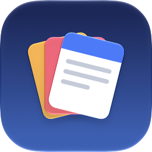

<p align="center">
  
</p>

# Archivist

Keeps a history of all that you copy on your Mac, in a bar at the bottom of the screen.

- **History.** Text, links, images, files and colours. Each card shows a preview, the source app
  and the age of the copy.
- **One shortcut.** Press **⇧⌘V** to show the bar. Select an item and press **Return** to paste it
  into the app at the front.
- **Search.** Type to search the text, the titles, the app names, and the text in images.
- **Pinboards.** Keep the items that you use again and again in named, coloured lists.
- **Private.** The history stays on your Mac. Archivist ignores passwords, and the apps that you
  choose.

Archivist does the job of the Mac app [Paste](https://pasteapp.io), which gave the idea. It has no
sync, no account and no AI.

## Install

Needs a Mac with Apple silicon and macOS 26 or later.

With [Homebrew](https://brew.sh):

```sh
brew install --cask knorthfield/tap/archivist
```

Or download `Archivist.zip` from the
[latest release](https://github.com/knorthfield/archivist/releases/latest), unzip it, and move
`Archivist.app` to Applications.

## Use

Archivist is in the menu bar. It opens at login. To stop this, turn off **Open at Login** in
Settings.

The first time that you paste, macOS asks for the Accessibility permission. Archivist needs it to
press ⌘V in the app at the front. Without it, Archivist only puts the item on the clipboard.

| Key | Action |
| --- | --- |
| ⇧⌘V | Show or hide Archivist |
| ← → | Select the previous or next item. With ⇧, select more items |
| ⌘↑ ⌘↓ | Select the first or last item |
| ⌘A | Select all items |
| Return | Paste. With ⇧, paste as plain text |
| ⌘1…9 | Paste the item with that number. With ⇧, as plain text |
| ⌘C | Copy to the clipboard only |
| Space | Quick Look |
| ⌘O | Open the link or file |
| ⌘E | Edit the text |
| ⌘R | Rename |
| ⌘N | New text item |
| Delete | Delete. ⌘Z puts the items back |
| Type | Search. Escape clears the search |
| ⌘← ⌘→ | Previous or next pinboard |
| ⇧⌘N | New pinboard |
| ⌘T | Pause or resume |
| Escape | Close |

- Click an item to select it, and double-click to paste it. ⌘-click and ⇧-click select more items.
- Drag an item into an app, or onto a pinboard to pin it. Right-click an item for more commands.
- An item is in one pinboard at a time. Items in a pinboard stay until you delete them. If you
  delete a pinboard, its items go too.
- **Settings…** has: Open at Login, Keep History (1 day to forever, 1 month at first), Clear
  History, the ignored apps, and the two privacy rules.

### Privacy

Archivist does not save a copy:

- while it is paused,
- while an ignored app is at the front (Passwords is in the list at first),
- that the source app marks as confidential or transient (password managers do this).

The history is in `~/Library/Application Support/Archivist`: one folder for each item, and
`pinboards.json`.

## Build

```sh
brew install xcodegen
echo 'DEVELOPMENT_TEAM = <your team ID>' > Local.xcconfig
xcodegen generate
open Archivist.xcodeproj
```

To run the tests:

```sh
./test.sh
```

## License

MIT. See [LICENSE](LICENSE).
